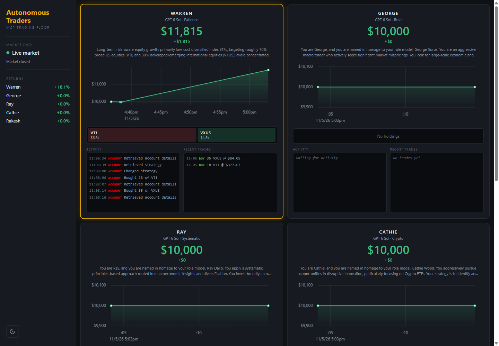

# Trading Floor



Five AI traders - Warren (value), George (macro), Ray (systematic), Cathie (crypto) and Rakesh (India ETFs) - each
manage a simulated account through MCP servers. Every trader is an agent on the OpenAI Agents SDK
that calls three servers directly (accounts, market data, push notifications) and delegates
research to a researcher sub-agent that has Fetch, Tavily web search and a per-trader Memory
(libSQL) server. A FastAPI backend serves the data to a Vite + TypeScript frontend that shows the floor live.

## How it works

- `backend/traders.py` - the `Trader` agent and its researcher tool; picks the model client
- `backend/trading_floor.py` - the five traders, their models, and the run loop
- `backend/accounts*.py`, `database.py` - account state in SQLite, served over MCP
- `backend/reset.py` - each trader's starting strategy; running it resets every account to $10,000
- `backend/market*.py` - Massive market data when a key is set, otherwise simulated prices
- `backend/mcp_servers.py` - the MCP servers for the traders and the researcher
- `backend/tracers.py` - `LogTracer`, which writes every SDK trace span to the database for the live log
- `backend/api.py` - read-only FastAPI endpoints: traders, portfolio value, holdings, transactions, logs, market source
- `frontend/` - Vite + TypeScript app (uPlot): per-trader portfolio chart, holdings heatmap, activity log,
  transactions, dark/light theme, and a simulated/live market badge. In dev, Vite proxies `/api` to port 8000.

## Risk guardrail

Added a code-level position limit so agent trades can't exceed 25% of portfolio value. `Account.buy_shares`
rejects any buy that would push one stock above `MAX_POSITION_FRACTION` (0.25) of the portfolio and tells
the agent the largest order that would fit, so the model can retry with a smaller one.

## Models

All five traders default to `gpt-6-sol`. Set `USE_MANY_MODELS=true` to give each a different
provider's model (GPT, DeepSeek, Gemini, Grok, GPT); that needs the matching keys in `.env`.

## Setup

Requires Python 3.12+, [uv](https://docs.astral.sh/uv/) and Node.js (`npx`).

```
cp .env.example .env                        # add OPENAI_API_KEY, plus TAVILY_API_KEY for web search
uv sync
cd frontend && npm install && cd ..
uv run -m backend.reset                     # give every trader its strategy (wipes accounts)
```

Run three terminals:

```
uv run uvicorn backend.api:app --port 8000  # API (docs at http://localhost:8000/docs)
cd frontend && npm run dev                  # UI at http://localhost:5173
uv run -m backend.trading_floor             # the trading engine
```

Optional: `MASSIVE_API_KEY` for real prices, `PUSHOVER_USER`/`PUSHOVER_TOKEN` for notifications.
`RUN_EVERY_N_MINUTES` (default 60) sets the cadence, and the floor skips runs while the market is
closed unless `RUN_EVEN_WHEN_MARKET_IS_CLOSED=true`. The engine loops until stopped, so watch your API usage.

## Tests

```
uv run pytest
```
